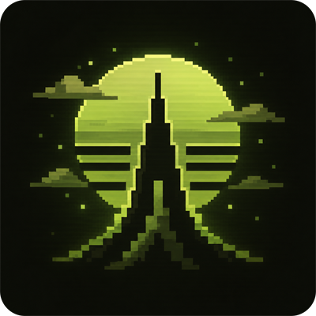
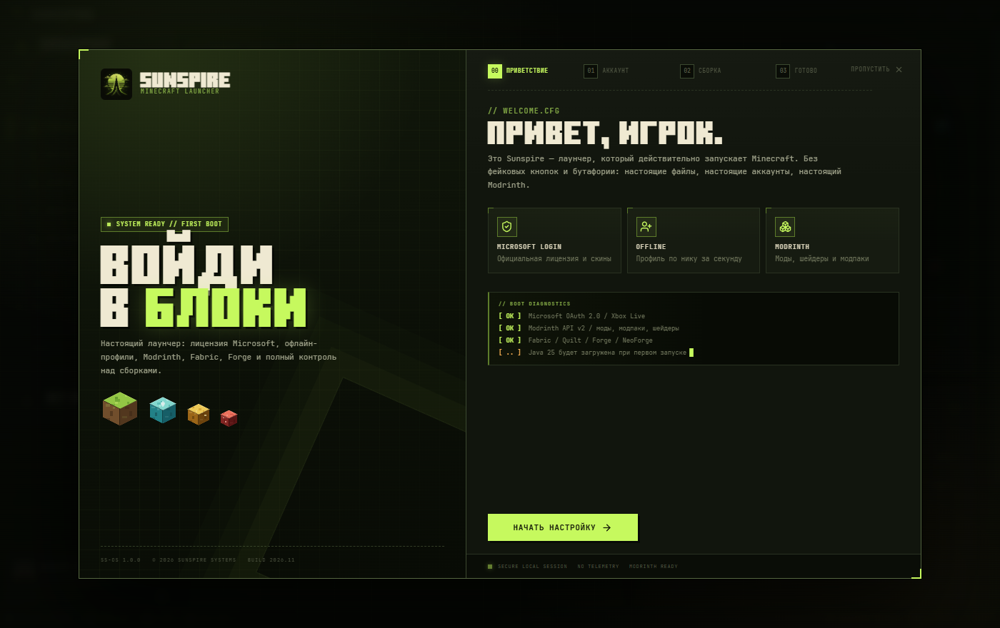
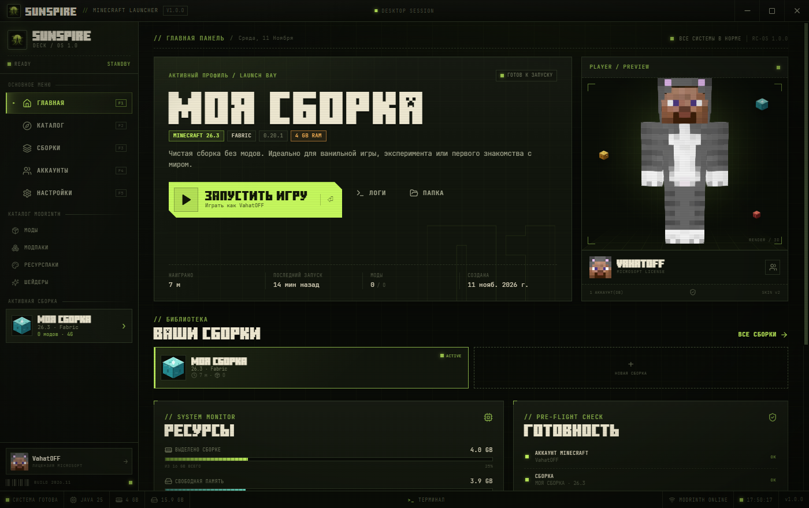
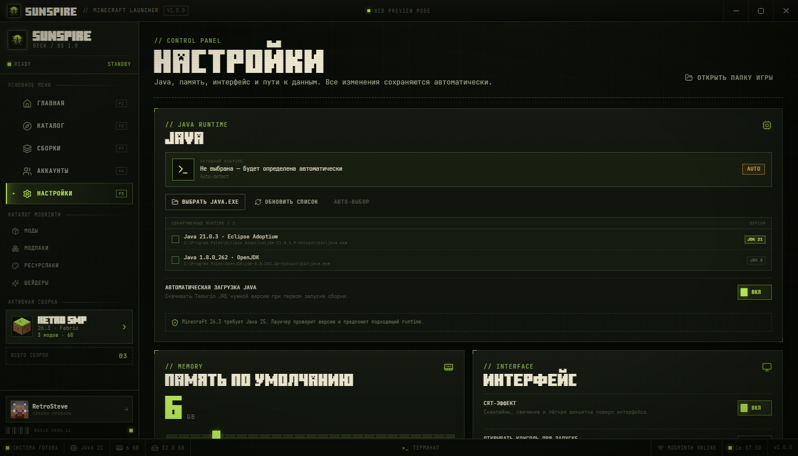

<div align="center">



# SUNSPIRE

**Ретро-лаунчер Minecraft на Rust / Tauri 2**

Настоящая лицензия Microsoft, офлайн-профили, каталог Modrinth, сборки и CRT-эстетика.

[](https://github.com/Cheboxar21/sunspire-launcher/releases/latest)
[](https://github.com/Cheboxar21/sunspire-launcher/releases)
[](LICENSE)
[](#скачать)
[](https://tauri.app)
[](https://boosty.to/mobbzi/donate)

[**Скачать**](https://github.com/Cheboxar21/sunspire-launcher/releases/latest) ·
[Возможности](#возможности) ·
[Скриншоты](#скриншоты) ·
[Сборка](#сборка-из-исходников) ·
[Поддержать](#поддержать-проект)

</div>



---

## Что это

**Sunspire** — лаунчер Minecraft, который действительно запускает Minecraft. Не мокап и не
обёртка над сайтом: Rust-ядро скачивает игру и библиотеки, ставит загрузчики, управляет модами
и запускает клиент с вашим аккаунтом.

Сверху — ретро-интерфейс: фосфорные панели, сканлайны, пиксельный шрифт и пять цветовых тем.
Внутри — рабочий инструмент: Microsoft OAuth 2.0, Modrinth, Fabric / Quilt / Forge / NeoForge,
Discord Rich Presence и автообновление.

## Возможности

| | |
|---|---|
| **Microsoft OAuth 2.0**<br>Официальный вход, лицензионные скины и доступ к серверам | **Офлайн-профили**<br>Ник, скин и игра без интернета |
| **Каталог Modrinth**<br>Моды, модпаки, ресурспаки и шейдеры — установка в один клик | **Сборки**<br>Fabric, Quilt, Forge, NeoForge, Vanilla. RAM, Java, аргументы, папка |
| **Управление модами**<br>Включение, отключение, удаление, локальные `.jar` | **5 тем**<br>Acid, Amber, Cyan, Magenta, Mono — переключение на лету |
| **Discord Rich Presence**<br>«В лаунчере», «Одиночная игра», «Сервер: host» | **Трей и фоновые загрузки**<br>Закрытие окна не прерывает игру и скачивание |
| **Автообновление**<br>Проверка `latest.json` / GitHub Releases | **Java**<br>Поиск установленных рантаймов и автозагрузка нужной версии |

## Скриншоты

| Главная | Настройки |
|---|---|
|  |  |

## Скачать

**[⬇ Sunspire-Setup.exe](https://github.com/Cheboxar21/sunspire-launcher/releases/latest)** — Windows 10/11, x64. Бесплатно, без регистрации и подписок.

1. Скачайте установщик из раздела [Releases](https://github.com/Cheboxar21/sunspire-launcher/releases/latest).
2. Запустите его. Установка идёт для текущего пользователя, без UAC.
3. Если Windows SmartScreen предупредит о неизвестном издателе (сборка не подписана
   платным сертификатом) — **Подробнее → Выполнить всё равно**.
4. Запустите **Sunspire** из меню «Пуск» или с рабочего стола.
5. Войдите через Microsoft или создайте офлайн-профиль.

Данные лаунчера, сборки, Java и логи хранятся в `%APPDATA%\Sunspire`.

SHA-256 установщика публикуется в `SHA256SUMS.txt` рядом с релизом.

## Поддержать проект

Sunspire бесплатный: без рекламы, подписок и закрытых функций. Если хочется отблагодарить
автора и ускорить развитие — есть Boosty.

<div align="center">

[](https://boosty.to/mobbzi/donate)

**[boosty.to/mobbzi/donate](https://boosty.to/mobbzi/donate)**

</div>

## Сборка из исходников

Нужны Node.js 20+, Rust stable и MinGW `dlltool` (для GNU-таргета) либо MSVC.

```bat
npm install
npm run tauri:build
```

Готовый установщик появится в `src-tauri/target/release/bundle/nsis/`.

Для разработки:

```bat
npm run tauri:dev
```

Подробности о Rust-ядре, обновлениях и переменных окружения — в [README-RUST.md](README-RUST.md).
Настройка Discord Rich Presence — в [DISCORD-SETUP.md](DISCORD-SETUP.md).

## Структура проекта

```
src/            React + TypeScript интерфейс (страницы, компоненты, темы)
src-tauri/      Rust-ядро: авторизация, запуск игры, Modrinth, моды, обновления
electron/       Electron-оболочка для веб-режима и отладки
public/         Шрифты, логотипы, иконки
scripts/        Сборка, тесты, захват скриншотов и рендер видео
github-release/ Тексты и инструкции для публикации релиза
docs/           Изображения для README
```

## Лицензия

Код лаунчера распространяется по лицензии [MIT](LICENSE).

Minecraft является торговой маркой Mojang Studios. Проект не связан с Mojang, Microsoft
или Modrinth. Игра не входит в комплект: лаунчер использует вашу лицензию или офлайн-профиль.
