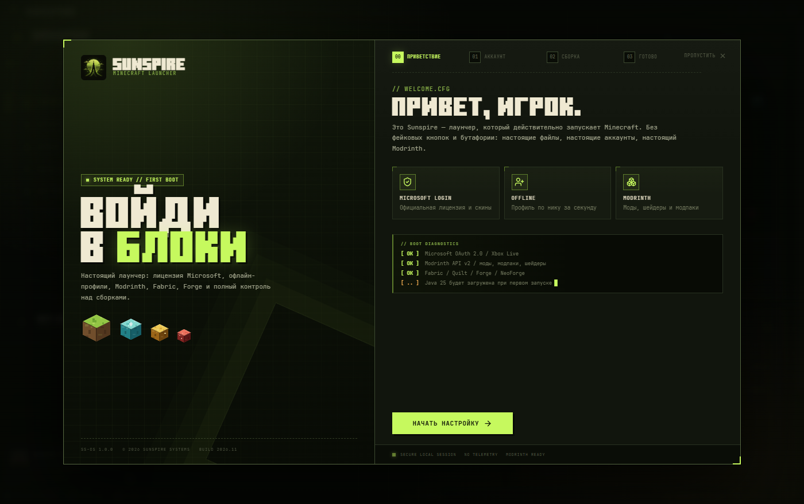

# Sunspire 1.0.0 — Retro Minecraft Launcher

Первый публичный релиз ретро-лаунчера Minecraft на Rust / Tauri 2.

## Что внутри

- Microsoft OAuth 2.0 и офлайн-профили
- Modrinth: моды, модпаки, ресурспаки, шейдеры
- Сборки Fabric / Quilt / Forge / NeoForge / Vanilla
- Управление модами: включение, выключение, удаление, локальные файлы
- 5 цветовых тем
- Discord Rich Presence: лаунчер / одиночная игра / сервер
- Трей и фоновые загрузки
- Автообновление
- Брендированный установщик

## Установка

Скачайте `Sunspire-Setup.exe` и запустите. Установка для текущего пользователя,
Windows 10/11 x64, без UAC. Данные хранятся в `%APPDATA%\Sunspire`.

Если Windows SmartScreen предупредит о неизвестном издателе — сборка не подписана платным
сертификатом: **Подробнее → Выполнить всё равно**.

## Файлы

- `Sunspire-Setup.exe` — установщик (~12 MB)
- `SHA256SUMS.txt` — контрольная сумма установщика

## Поддержать проект

Sunspire бесплатный. Если хочется отблагодарить автора — [Boosty](https://boosty.to/mobbzi/donate).

---

Minecraft является торговой маркой Mojang Studios. Проект не связан с Mojang,
Microsoft или Modrinth.
